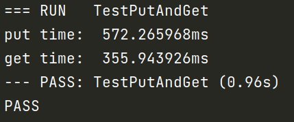
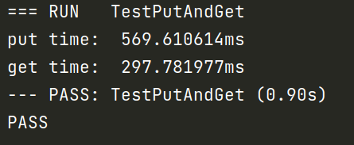

   [](https://pkg.go.dev/github.com/ByteStorage/flydb)            [](https://goreportcard.com/report/github.com/qishenonly/flydb) 

English | [简体中文](https://github.com/ByteStorage/flydb/blob/master/README_CN.md)


**FlyDB** aims to serve as an alternative to in-memory key-value storage (such as **Redis**) in some cases, aiming to strike a balance between performance and storage cost. It does this by optimizing resource allocation and using cost-effective storage media. By intelligently managing data, **FlyDB** ensures efficient operations while minimizing storage costs. It provides a reliable solution for scenarios that require a balance between performance and storage costs.

## 📚 What is FlyDB ?

**FlyDB** is a high-performance key-value (KV) storage engine based on the efficient bitcask model. It offers fast and reliable data retrieval and storage capabilities. By leveraging the simplicity and effectiveness of the bitcask model, **FlyDB** ensures efficient read and write operations, resulting in improved overall performance. It provides a streamlined approach to storing and accessing key-value pairs, making it an excellent choice for scenarios that require fast and responsive data access. **FlyDB's** focus on speed and simplicity makes it a valuable alternative for applications that prioritize performance while balancing storage costs. 

## 🧩 Supported data structures

On top of the bitcask engine, FlyDB provides Redis-style data structures in the `structure` package:

| Data structure | Constructor | Representative operations |
| -------------- | ----------- | ------------------------- |
| String | `structure.NewStringStructure` | `Set` / `Get` / `Del`, `Expire` / `TTL`, `Incr` / `Decr` / `IncrBy`, `GetRange` / `SetRange`, `SetBit` / `GetBit` / `BitCount`, `MSetNX` / `MGet` |
| Hash | `structure.NewHashStructure` | `HSet` / `HGet` / `HDel`, `HMSet` / `HGetAll`, `HKeys` / `HVals`, `HIncrBy` / `HIncrByFloat`, `HSetNX`, `HExpire` |
| List | `structure.NewListStructure` | `LPush` / `RPush`, `LPop` / `RPop`, `LRange` / `LIndex` / `LSet` / `LTrim`, `LRem` / `LInsert`, `LMOVE` / `RPOPLPUSH`, `BLPOP` / `BRPOP` |
| Set | `structure.NewSetStructure` | `SAdd` / `SRem`, `SCard` / `SMembers` / `SIsMember`, `SUnion` / `SInter` / `SDiff` |
| Sorted set | `structure.NewZSetStructure` | `ZAdd` / `ZRem`, `ZScore` / `ZRank` / `ZRevRank`, `ZRange` |
| Bitmap | `structure.NewBitmap` | `SetBit` / `GetBit`, `SetBits` / `GetBits`, `DelBit`, `BitCount`, `BitOp` |
| Stream | `structure.NewStreamStructure` | `XAdd` / `XRead` / `XDel`, `XLen` / `XRange` / `XRevRange`, `XTrim`, `XGroup` |
| Expiring keys | `structure.NewExpireStructure` | `EXPIRE` / `PEXPIRE` / `EXPIREAT` / `PEXPIREAT`, `PERSIST` |

Every constructor opens its own database handle on `options.DirPath`. Give each structure its own directory when using several of them, or use one structure per database directory.

> See [examples/](./examples) for runnable programs (`go run ./examples`).

## 🏁  Fast Start: FlyDB 

You can install FlyDB using the Go command line tool:

```GO
go get github.com/ByteStorage/FlyDB@v1.1.0
```

Or clone this project from github:

```bash
git clone https://github.com/ByteStorage/FlyDB.git
```

## 🖥 How to use FlyDB ?

### Used by Golang SDK

Here is a simple example of how to use the Linux version:

> See flydb/examples for details.

```go
package main

import (
	"fmt"

	"github.com/ByteStorage/FlyDB/config"
	"github.com/ByteStorage/FlyDB/flydb"
)

func main() {
	options := config.DefaultOptions
	options.DirPath = "/tmp/flydb"

	db, err := flydb.NewFlyDB(options)
	if err != nil {
		panic(err)
	}

	if err := db.Put([]byte("name"), []byte("flydb-example")); err != nil {
		panic(err)
	}

	val, err := db.Get([]byte("name"))
	if err != nil {
		panic(err)
	}
	fmt.Println("name value =>", string(val))

	if err := db.Delete([]byte("name")); err != nil {
		panic(err)
	}
}
```

### Used by the data structure API

```go
package main

import (
	"fmt"

	"github.com/ByteStorage/FlyDB/config"
	"github.com/ByteStorage/FlyDB/structure"
)

func main() {
	options := config.DefaultOptions
	options.DirPath = "/tmp/flydb-structure"

	str, err := structure.NewStringStructure(options)
	if err != nil {
		panic(err)
	}

	// ttl is in seconds; 0 means the key never expires
	if err := str.Set("user:1:name", "flydb", 0); err != nil {
		panic(err)
	}

	name, err := str.Get("user:1:name")
	if err != nil {
		panic(err)
	}
	fmt.Println("user:1:name =>", name)

	keys, err := str.Keys("user:*")
	if err != nil {
		panic(err)
	}
	fmt.Println("keys =>", keys)
}
```

### Used By Shell Command

```shell
./build.sh
```

### Used By Docker

```shell
docker run -d --name flydb-server --network=host -p 8999:8999 bytestorage/flydb:v1.0
```

### Used By Kubernetes

```shell
kubectl apply -f kubernetes/flydb-namespace.yaml
kubectl apply -f kubernetes/flydb-deployment.yaml
kubectl apply -f kubernetes/flydb-service.yaml
kubectl wait --for=condition=ready pod -l app=flydb -n flydb-system
kubectl port-forward svc/flydb-service -n flydb-system 8999:8999
```

**When install flydb server by shell/docker/kubernetes, you can use the flydb-cli to connect the flydb server.**

```shell
./bin/flydb-client 127.0.0.1:8999
```

## 🚀 Performance test

We did a simple performance test of the V1.0.4 version of FlyDB. This test mainly focused on reading and writing large-scale data, and we selected 500,000 random data for testing.

Through testing, we found that in V1.0.4, with 500,000 data:

#### BTree Index

PUT performance: 572.265968ms

GET performance: 355.943926ms



#### ARTree Index

PUT performance: 569.610614ms

GET performance: 297.781977ms




If you have a better way to optimize read and write performance, please submit your 'pr'.

## 📢 Benchmark test

We compared the results of a benchmark test using FlyDB V1.0.4 with other kv databases written in golang on the market and found that the read/write performance test results exceeded most open source kv databases.

> See in detail: https://github.com/ByteStorage/contrast-benchmark

```
goos: linux
goarch: amd64
pkg: contrast-benchmark
cpu: 11th Gen Intel(R) Core(TM) i7-11800H @ 2.30GHz

Benchmark_PutValue_FlyDB
Benchmark_PutValue_FlyDB-16        	   95023	     13763 ns/op	    2904 B/op	      16 allocs/op
Benchmark_GetValue_FlyDB
Benchmark_GetValue_FlyDB-16    	 	 2710143	     463.5 ns/op	     259 B/op	       5 allocs/op
Benchmark_PutValue_Badger
Benchmark_PutValue_Badger-16       	   59331	     22711 ns/op	    6006 B/op	      48 allocs/op
Benchmark_GetValue_Badger
Benchmark_GetValue_Badger-16       	  158686	      7686 ns/op	   10844 B/op	      42 allocs/op
Benchmark_PutValue_BoltDB
Benchmark_PutValue_BoltDB-16       	   32637	     56519 ns/op	   21009 B/op	     123 allocs/op
Benchmark_GetValue_BoltDB
Benchmark_GetValue_BoltDB-16       	  655971	     24327 ns/op	     723 B/op	      26 allocs/op 
Benchmark_PutValue_GoLevelDB
Benchmark_PutValue_GoLevelDB-16    	   71931	     14709 ns/op	    2226 B/op	      12 allocs/op
Benchmark_GetValue_GoLevelDB
Benchmark_GetValue_GoLevelDB-16    	  500736	      2520 ns/op	    1278 B/op	      15 allocs/op
Benchmark_PutValue_NutsDB
Benchmark_PutValue_NutsDB-16       	   78801	     13582 ns/op	    3242 B/op	      22 allocs/op
Benchmark_GetValue_NutsDB
Benchmark_GetValue_NutsDB-16       	  373124	      5702 ns/op	    1392 B/op	      14 allocs/op
Benchmark_PutValue_RoseDB
Benchmark_PutValue_RoseDB-16       	   69776	     19166 ns/op	    6242 B/op	      59 allocs/op
Benchmark_GetValue_RoseDB
Benchmark_GetValue_RoseDB-16       	 4155183	     298.0 ns/op	     167 B/op	       4 allocs/op
Benchmark_PutValue_Pebble
Benchmark_PutValue_Pebble-16       	   91304	     21877 ns/op	    2720 B/op	       8 allocs/op
Benchmark_GetValue_Pebble
Benchmark_GetValue_Pebble-16       	   66135	     15837 ns/op	   17193 B/op	      22 allocs/op
PASS
```

## 🔮 How to contact us ?

If you have any questions and want to contact us, you can contact our developer team, we will reply to your email:

Team Email: bytestoragecommunity@gmail.com

Or add my wechat, invite you to enter the project community, and code masters together to exchange learning.

> Add wechat please comment Github


## ✅ TODO List

- [x] Data structure support: string, hash, list, set, sorted set, bitmap, stream and expiring keys.
- [ ] Compatible with Redis protocols and commands.
- [x] Support http services.
- [x] Support tcp services.
- [x] Log aggregation
- [ ] Data backup
- [ ] Distributed cluster model.

## 📜 Version update doc

> See in detail: [Version-update-document](https://github.com/ByteStorage/FlyDB/blob/master/docs/version_update.md)

## 👀 Contributor

<a href="https://github.com/ByteStorage/FlyDB/graphs/contributors">

 
</a>

## 📝 How to contribute ?

If you have any ideas or suggestions for FlyDB, please feel free to submit 'issues' or' pr 'on GitHub. We welcome your contributions!

> Please refer to the complete specification procedure：[CONTRIBUTEING](https://github.com/ByteStorage/flydb/blob/master/CONTRIBUTING.md)

## 📋 Licence

FlyDB is released under the Apache license. For details, see LICENSE file.

## Thanks To JetBrains

> Thanks to `JetBrains` for the free open source license.  


